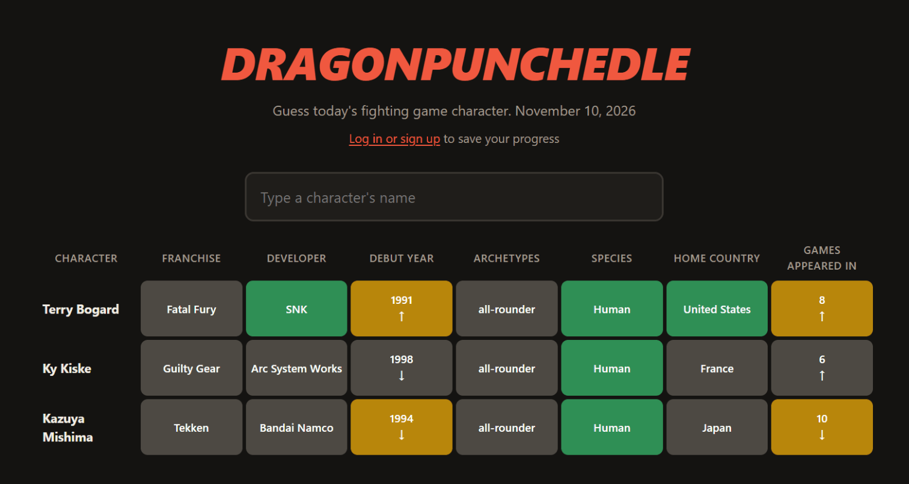
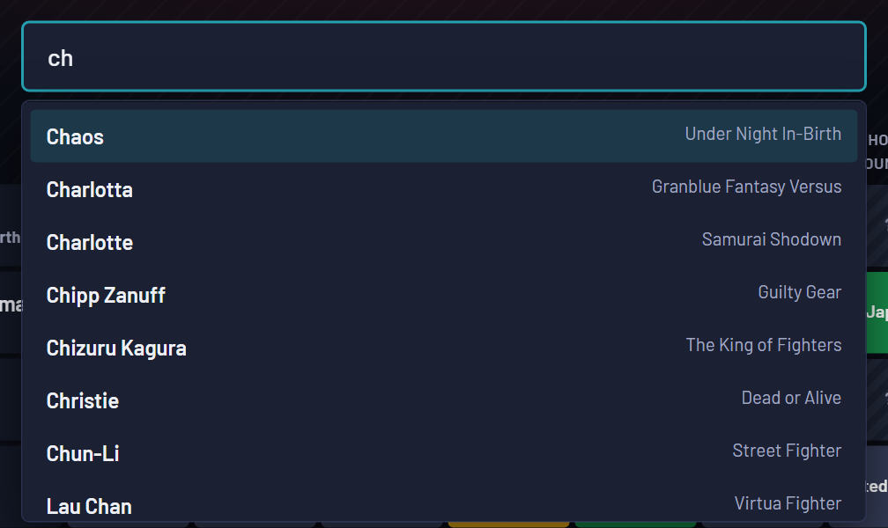
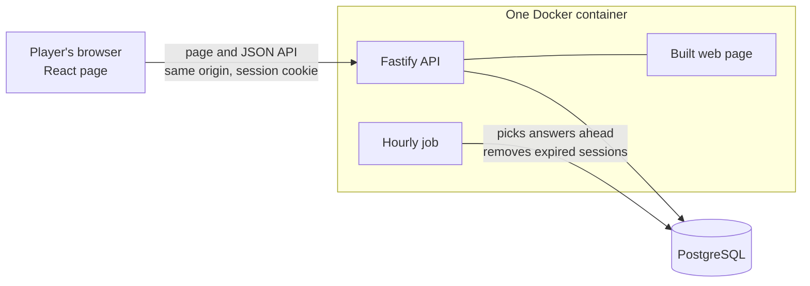
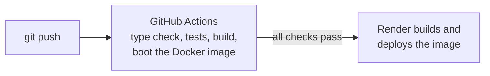

# Dragonpunchedle

A daily guessing game for fighting game characters. Every day there's one mystery fighter, picked from 274 characters across 17 franchises. Each guess shows how close you are, clue by clue: franchise, developer, debut year, archetypes, species, home country and number of games.



- 🟩 **Green:** an exact match.
- 🟨 **Yellow:** close. That means a shared archetype, a country on the same continent, or a number near the answer.
- ⬛ **Grey:** not it.
- **Arrows:** whether the answer's year or game count is higher or lower.

Play as a guest, or make an account to keep your board on every device, build a streak and appear on the leaderboards. When you win, share a spoiler-free grid of squares.

The guess box suggests names as you type. It ignores capitals, accents and punctuation, and works from the keyboard or a screen reader.



## Stack

| | |
|---|---|
| **Frontend** | React 19, TypeScript, Vite |
| **Backend** | Node.js 24, Fastify 5, TypeScript |
| **Database** | PostgreSQL 17, plain SQL migrations |
| **Tests** | Vitest: unit tests, and integration tests against a real database |
| **Delivery** | Docker, GitHub Actions, Render, Neon |

## Architecture



One container serves both the page and the API. Because they share an origin, the login cookie needs no cross-site setup, and only one service has to be deployed.



## Design decisions

**The answer never reaches the browser.** The page only ever receives the character list and the colour of each clue, so nobody can find the answer by opening the developer tools. Guesses are checked on the server ([`routes/puzzles.ts`](apps/api/src/routes/puzzles.ts)).

**Clues are data, not code.** Each clue has a kind:
- **exact:** match or no match.
- **set:** overlap counts as partial.
- **number:** higher or lower, with a "close" range.

The comparison logic is written once per kind. Adding a clue is one line in [`clues.ts`](apps/api/src/game/clues.ts) plus the data; [`compare.ts`](apps/api/src/game/compare.ts) doesn't change.

**Streaks are calculated, not stored.** They're derived from saved guesses with a "gaps and islands" SQL query. A counter column would have to be updated correctly on every write, forever, while a derived value can't drift out of sync with the guesses ([`db/stats.ts`](apps/api/src/db/stats.ts)).

**The daily job is idempotent and runs hourly.** It doesn't try to fire at exactly midnight. Every step gives the same result whether it runs once, twice, or on two servers at the same moment, so a restart or a missed run can't leave a day without a puzzle. Answers are picked a week ahead. If two requests race to pick the same day, the database's unique key decides, and both get the same answer ([`jobs/daily.ts`](apps/api/src/jobs/daily.ts), [`game/puzzles.ts`](apps/api/src/game/puzzles.ts)).

**Accounts** ([`auth/`](apps/api/src/auth)):
- **Passwords** are hashed with scrypt, with a random salt each, and compared in constant time.
- **No username probing:** a login for an unknown user takes as long as one with a wrong password, and gets the same message.
- **Session tokens** are random. Only a SHA-256 of each is stored, so a leaked database can't be used to log in.
- **The cookie** is `HttpOnly`, `SameSite=Lax`, and `Secure` in production.
- **Rate limiting:** login and sign-up are limited per IP. Behind a proxy, that only works if the proxy is trusted for the real client address (`TRUST_PROXY`), otherwise every player shares one limit.

**Migrations are plain SQL**, run by a small runner ([`db/migrate.ts`](apps/api/src/db/migrate.ts)):
- each file runs in its own transaction;
- applied files are recorded, so running again only applies new ones;
- a Postgres advisory lock stops two server instances from migrating at once.

**Typed-ahead guesses are queued.** A guess picked while the previous one is still being checked waits its turn, instead of being dropped. Enter matches against what's actually in the box at that moment, so a paste followed by Enter works too ([`App.tsx`](apps/web/src/App.tsx), [`GuessInput.tsx`](apps/web/src/GuessInput.tsx)).

**The roster is validated before it reaches the database.** 274 characters live in JSON files under [`apps/api/data/roster`](apps/api/data/roster), and they're checked with zod on every load:
- archetypes and species must come from fixed lists;
- a misspelled country fails;
- duplicate characters fail.

The server syncs the roster on every start, so corrected data only needs a redeploy.

**The Docker image** ([`Dockerfile`](Dockerfile)):
- **Multi-stage:** the second stage keeps only production dependencies and compiled code.
- **Unprivileged:** it runs as a non-root user, and the app's own files are read-only to it.
- **Health check** on `/api/health`.
- **Tested in CI:** CI builds the image and boots it against a real database on every push, which proves it starts, not just that it compiles.

## Running it locally

You need Node.js 22 or newer and Docker.

```bash
npm install
cp apps/api/.env.example apps/api/.env
npm run db:up        # PostgreSQL in Docker
npm run db:migrate
npm run db:seed      # load the 274 characters
npm run dev:api      # API on http://localhost:3000
npm run dev:web      # game on http://localhost:5180
```

| Command | What it does |
|---|---|
| `npm test` | All tests. The database tests need `npm run db:up` first. |
| `npm run typecheck` | TypeScript checks for both apps |
| `npm run app:up` | Builds the production image and runs it with the database on http://localhost:8180 |
| `npm run job:daily` | Runs the daily job once |
| `npm run db:down` | Stops the database. Data is kept. |

## Project layout

```
apps/
  api/
    src/
      game/        clue definitions, comparison, daily answers, roster validation
      auth/        password hashing, sessions
      db/          queries, migration runner, seeding
      routes/      HTTP endpoints
      jobs/        daily job and scheduler
    migrations/    SQL, applied in order
    data/roster/   one JSON file per franchise
    test/
  web/
    src/           React components, API client, search, share text
    brand/         sources for the preview image and icon
Dockerfile
render.yaml        production setup (Render Blueprint)
```

## Deployment

[`render.yaml`](render.yaml) describes production: a free Docker web service on Render that deploys only after CI passes, plus a free PostgreSQL database on Neon. Use Neon's *direct* connection string. The pooled one hands out connections per transaction, which breaks the session-level lock that guards migrations.

## Disclaimer

A fan project, not affiliated with or endorsed by any game publisher. Character and franchise names belong to their respective owners. The game uses names and facts only, with no official art.
