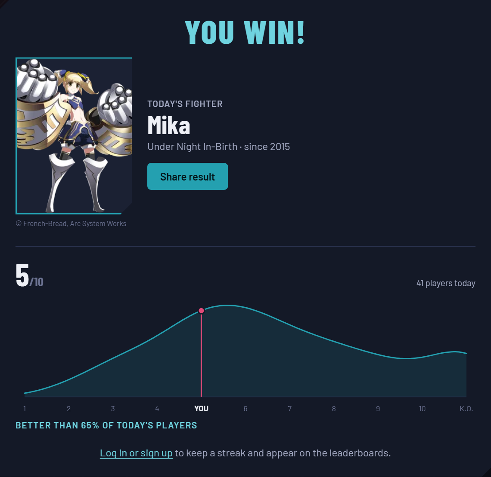
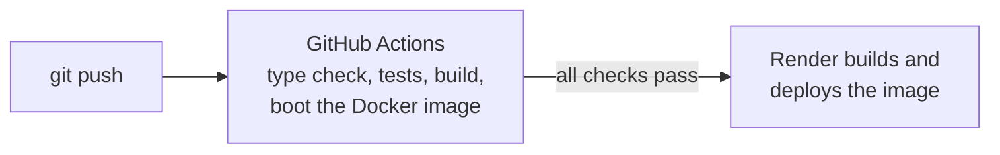

# Dragonpunchedle

A daily guessing game for fighting game characters. Every day there's one mystery fighter, picked from 295 characters across 18 franchises, from Street Fighter and Tekken to Guilty Gear, King of Fighters and Marvel Tōkon. You get 10 guesses. Each one shows how close you are, clue by clue: franchise, developer, debut year, archetypes, species, gender, home country and number of games.

**Play it at [dragonpunchedle.onrender.com](https://dragonpunchedle.onrender.com).** It runs on a free server that sleeps when nobody is playing, so the first visit after a quiet spell can take about a minute to load.


- 🟩 **Green:** an exact match.
- 🟨 **Yellow:** close. That means a shared archetype, a country on the same continent, or a number near the answer.
- ⬛ **Grey:** not it.
- **Arrows:** the answer's year or game count is higher (▲, above the value) or lower (▼, below it).
- The **health bar** is your guesses left: green, then yellow, then red for the last 3.

The guess box suggests names as you type. It ignores capitals, accents and punctuation, and works from the keyboard or a screen reader.


When the round ends you get the character's portrait and a curve of how everyone did today, with your result marked. Share a spoiler-free grid of squares, or sign in with Google or a username to keep a streak and appear on the leaderboards.



## Stack

| | |
|---|---|
| **Frontend** | React 19, TypeScript, Vite |
| **Backend** | Node.js 24, Fastify 5, TypeScript |
| **Database** | PostgreSQL 17, plain SQL migrations |
| **Tests** | Vitest: unit tests, and integration tests against a real database |
| **Delivery** | Docker, GitHub Actions, Render, Neon |

## Architecture


One container serves both the page and the API. Because they share an origin, the login cookie needs no cross-site setup, and only one service has to be deployed.



## Design decisions

**The answer never reaches the browser.** The page only ever receives the character list and the colour of each clue, so nobody can find the answer by opening the developer tools. Guesses are checked on the server ([`routes/puzzles.ts`](apps/api/src/routes/puzzles.ts)).

**Clues are data, not code.** Each clue has a kind:
- **exact:** match or no match.
- **set:** overlap counts as partial.
- **number:** higher or lower, with a "close" range.

The comparison logic is written once per kind. Adding a clue is one line in [`clues.ts`](apps/api/src/game/clues.ts) plus the data; [`compare.ts`](apps/api/src/game/compare.ts) doesn't change.

**Streaks are calculated, not stored.** They're derived from saved guesses with a "gaps and islands" SQL query. A counter column would have to be updated correctly on every write, forever, while a derived value can't drift out of sync with the guesses ([`db/stats.ts`](apps/api/src/db/stats.ts)).

**The daily job is idempotent and runs hourly.** It doesn't try to fire at exactly midnight. Every step gives the same result whether it runs once, twice, or on two servers at the same moment, so a restart or a missed run can't leave a day without a puzzle. Answers are picked a week ahead. If two requests race to pick the same day, the database's unique key decides, and both get the same answer ([`jobs/daily.ts`](apps/api/src/jobs/daily.ts), [`game/puzzles.ts`](apps/api/src/game/puzzles.ts)).

**Accounts** ([`auth/`](apps/api/src/auth)):
- **Sign in with Google** uses OAuth 2.0's authorization code flow, with a single-use `state` cookie against forged callbacks and PKCE ([`auth/oauth.ts`](apps/api/src/auth/oauth.ts)). It asks only for an id and a name, never an email. The token is used once to read the profile, then dropped. A provider only appears when its keys are set. Discord sign-in is built and tested but switched off on the live site: Chrome's phishing protection flagged its callback, because Discord account-stealing pages on shared free hosts look just like it. A custom domain would be the fix.
- **Weak passwords are refused** at sign-up. [zxcvbn](https://github.com/zxcvbn-ts/zxcvbn) estimates how guessable a password is (common passwords, keyboard patterns, l33t speak, the username), as current NIST guidance suggests, instead of "one capital, one symbol" rules. The sign-up form imports the same file for its strength meter, so the page and the server never disagree.
- **Passwords** are hashed with scrypt, with a random salt each, and compared in constant time.
- **No username probing:** a login for an unknown user takes as long as one with a wrong password, and gets the same message.
- **Session tokens** are random. Only a SHA-256 of each is stored, so a leaked database can't be used to log in.
- **The cookie** is `HttpOnly`, `SameSite=Lax`, and `Secure` in production.
- **Security headers** ([@fastify/helmet](https://github.com/fastify/fastify-helmet)): a Content-Security-Policy that only runs the site's own scripts, no framing by other sites, HSTS, `nosniff` and `no-referrer`.
- **Rate limiting:** login and sign-up are limited per IP, and so are guesses (120 a minute: plenty for a person, a brake on a script). Behind a proxy, that only works if the proxy is trusted for the real client address (`TRUST_PROXY`), otherwise every player shares one limit.

**Migrations are plain SQL**, run by a small runner ([`db/migrate.ts`](apps/api/src/db/migrate.ts)):
- each file runs in its own transaction;
- applied files are recorded, so running again only applies new ones;
- a Postgres advisory lock stops two server instances from migrating at once.

**Ten guesses a day, enforced by the database.** The checks (already solved? already guessed? out of guesses?) and the insert run in one transaction that first takes a Postgres advisory lock for that player, so two guesses sent at the same moment can't both become the 10th. A test fires 15 at once and gets exactly 10 ([`db/guesses.ts`](apps/api/src/db/guesses.ts)). The answer is sent only with a missed 10th guess.

**Guests are players too.** A guest's first guess gives the browser an anonymous id in an `HttpOnly` cookie (24 random bytes, nothing personal), and their guesses are stored under it. So a guest's board survives a reload, the 10-guess limit is enforced on the server for them as well, and they count in the results chart. Logging in moves that browser's guesses for today into the account, so nobody is counted twice. Guest guesses are deleted after 30 days by the daily job ([`auth/guests.ts`](apps/api/src/auth/guests.ts)).

**The results chart** is a smooth curve of how everyone finished today, from 1 guess to K.O. One SQL query counts finished rounds only, so a round in progress isn't a loss ([`db/stats.ts`](apps/api/src/db/stats.ts)). The page draws it as an SVG at its real width (so labels stay readable on phones), adding a small Gaussian bump per result. Hovering shows exact counts, and a hidden table gives screen readers the numbers ([`ResultsChart.tsx`](apps/web/src/ResultsChart.tsx)).

**Character portraits live in the database, not in this repository.** The art belongs to each game's publisher. Keeping it out of the public repo means a takedown request can never put the code at risk, and removing a franchise is one command with no redeploy. A small CLI ([`portraits/cli.ts`](apps/api/src/portraits/cli.ts)) downloads source images into a git-ignored folder, crops them to 240×320 WebP cards with sharp, and stores them with an ownership credit. Images are served with a one-day cache and a hash in the address, so a replaced image shows up at once and a removed one disappears within a day. Characters without a portrait (all of Marvel Tōkon, by choice) show an initials card instead:

```bash
npm run portraits -- status                          # which characters still need one
npm run portraits -- fetch                           # download apps/api/portraits/sources.json
npm run portraits -- import                          # crop, convert and store
npm run portraits -- remove --franchise "Tekken"     # takedown
# add --prod to target the live database (address read from apps/api/.env.production)
```

**Typed-ahead guesses are queued.** A guess picked while the previous one is still being checked waits its turn, instead of being dropped. Enter matches against what's actually in the box at that moment, so a paste followed by Enter works too ([`App.tsx`](apps/web/src/App.tsx), [`GuessInput.tsx`](apps/web/src/GuessInput.tsx)).

**The roster is validated before it reaches the database.** 295 characters live in JSON files under [`apps/api/data/roster`](apps/api/data/roster), and they're checked with zod on every load:
- archetypes and species must come from fixed lists;
- a misspelled country fails;
- duplicate characters fail.

The rules for each clue are written next to it in [`clues.ts`](apps/api/src/game/clues.ts). For example, games appeared in counts a series' own fighting games, never crossovers, with one deliberate exception: the Marvel vs. Capcom series counts for both its Marvel and its Capcom characters.

The server syncs the roster on every start, so corrected data only needs a redeploy.

**The Docker image** ([`Dockerfile`](Dockerfile)):
- **Multi-stage:** the second stage keeps only production dependencies and compiled code.
- **Unprivileged:** it runs as a non-root user, and the app's own files are read-only to it.
- **Health check** on `/api/health`.
- **Tested in CI:** CI builds the image and boots it against a real database on every push, which proves it starts, not just that it compiles.

## Running it locally

You need Node.js 22 or newer and Docker.

```bash
npm install
cp apps/api/.env.example apps/api/.env
npm run db:up        # PostgreSQL in Docker
npm run db:migrate
npm run db:seed      # load the 295 characters
npm run dev:api      # API on http://localhost:3000
npm run dev:web      # game on http://localhost:5180
```

| Command | What it does |
|---|---|
| `npm test` | All tests. The database tests need `npm run db:up` first. |
| `npm run typecheck` | TypeScript checks for both apps |
| `npm run app:up` | Builds the production image and runs it with the database on http://localhost:8180 |
| `npm run job:daily` | Runs the daily job once |
| `npm run db:down` | Stops the database. Data is kept. |

## Project layout

```
apps/
  api/
    src/
      game/        clue definitions, comparison, daily answers, roster validation
      auth/        passwords, sessions, guest ids, Google/Discord sign-in
      db/          queries, migration runner, seeding
      routes/      HTTP endpoints
      jobs/        daily job and scheduler
    migrations/    SQL, applied in order
    data/roster/   one JSON file per franchise
    test/
  web/
    src/           React components, API client, search, share text
    brand/         sources for the preview image and icon
Dockerfile
render.yaml        production setup (Render Blueprint)
```

## Deployment

[`render.yaml`](render.yaml) describes production: a free Docker web service on Render that deploys only after CI passes, plus a free PostgreSQL database on Neon. Use Neon's *direct* connection string. The pooled one hands out connections per transaction, which breaks the session-level lock that guards migrations.

## Credits

Built with [Claude Code](https://claude.com/claude-code) as a pair programmer.

## Disclaimer

An unofficial, non-commercial fan project, not affiliated with or endorsed by any game publisher. Character names, artwork and franchises belong to their respective owners, credited under each portrait in the game. No artwork is stored in this repository. To have something removed, email pedromakesstuff0@gmail.com.

Dragonpunchedle isn't endorsed by Riot Games and doesn't reflect the views or opinions of Riot Games or anyone officially involved in producing or managing Riot Games properties. Riot Games, and all associated properties are trademarks or registered trademarks of Riot Games, Inc.
